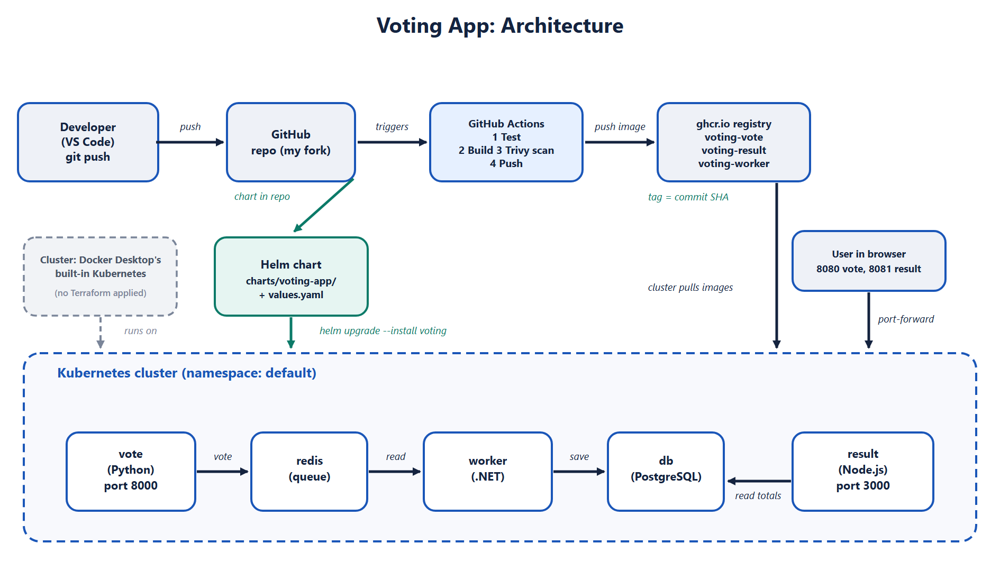

# Voting App: From Code to Automatic Deployment

This is my fork of `dockersamples/example-voting-app`, prepared for the TS Academy DevOps Capstone 1 ("Ship It"). The goal is simple: one push builds the images, scans them, pushes them to a registry, and the app can be deployed to Kubernetes with Helm and rolled back when a release goes bad.

The original upstream README is kept as [README-upstream.md](README-upstream.md).

## What the app does

A small voting app made of five parts.

| Part | What it does |
|---|---|
| vote | Web page where you cast a vote (Python, Flask) |
| redis | Queue that holds votes until they are processed |
| worker | Reads votes from Redis and saves them to the database (.NET) |
| db | PostgreSQL database that stores the votes |
| result | Web page that shows live totals (Node.js) |

Data flow: you vote in **vote**, the vote waits in **Redis**, the **worker** saves it to **PostgreSQL**, and **result** shows the totals.

## Architecture



```
Developer -> GitHub -> GitHub Actions (test, Trivy scan, build, push)
                              |
                              v
                      ghcr.io registry (images tagged with commit SHA)
                              |
                              v
   Helm chart -> Kubernetes (Docker Desktop, namespace: default)
                    vote, result, worker, redis, db
```

## 1. Run it locally

Requirements: Docker Desktop and Git.

1. Clone my fork: `git clone https://github.com/famousvic/example-voting-app.git`
2. Go into the folder: `cd example-voting-app`
3. Start everything: `docker compose up --build`
4. Vote page: http://localhost:8080
5. Result page: http://localhost:8081
6. Stop it with Ctrl+C, then run `docker compose down`

## 2. Containers

Each service has its own Dockerfile (`vote/`, `result/`, `worker/`).

What I changed and checked:

- Base images are pinned by tag and digest (still Python 3.11, Node 18 and .NET 7, the same versions as upstream), never `latest`.
- Every service runs as a non-root user: `app` (uid 10001) for vote and worker, the built-in `node` user (uid 1000) for result. I confirmed this by running `id` inside each container.
- Because a non-root user cannot bind port 80, vote now listens on 8000 and result on 3000. `docker-compose.yml` and `seed-data/generate-votes.sh` were updated to match. The URLs on my machine are unchanged (8080 and 8081).
- I added a `.dockerignore` to each service so `.git`, `node_modules`, markdown files and `.env` files stay out of the image.

Honest note: the upstream Dockerfiles used unpinned tags and ran as root. The pinning, the non-root users and the port changes are my changes, made with the help of Claude Code, and can be seen in the git history (`git diff 63e9150 HEAD -- '*/Dockerfile'`).

## 3. Kubernetes cluster

I did not write or apply any Terraform, so there is no `terraform/` folder and no destroy-and-recreate proof. For the Helm deployment and the rollback demo I used the Kubernetes cluster built into Docker Desktop (one node, `desktop-control-plane`).

## 4. CI pipeline (GitHub Actions)

The workflow is `.github/workflows/ci.yml`. It runs on every push, once for each of vote, result and worker. I removed the three upstream `call-docker-build-*` workflows.

Steps, in order:

1. **Test**: a basic Python syntax check on the vote app (`py_compile`). This is a simple test, not a full test suite.
2. **Build**: builds the Docker image.
3. **Scan**: Trivy scans the image for HIGH and CRITICAL vulnerabilities. It is set to report only and not fail the build, because the Node 18 and .NET 7 base images are past end of life and show findings.
4. **Login**: logs in to GitHub Container Registry with the `GITHUB_TOKEN` that GitHub creates for each run.
5. **Push**: pushes the image tagged with the commit SHA, never `latest`.

Images are published to `ghcr.io/famousvic/voting-vote`, `voting-result` and `voting-worker`.

Things I fixed along the way: the first run failed because the Trivy action tag was missing its `v`, and the second failed because Trivy v0.28.0 depends on a `setup-trivy` tag that no longer exists. I moved to `aquasecurity/trivy-action@v0.36.0` and the later runs passed. The red runs stay in the Actions history.

## 5. Deploy and roll back with Helm

One chart in `charts/voting-app/`, one `values.yaml`. Image registry, tag, ports and user IDs are set in `values.yaml`. The chart is `voting-app`; the installed release is `voting`.

Deploy:

```
helm upgrade --install voting charts/voting-app
kubectl get pods
```

Open the app (stop `docker compose` first, or use other local ports):

```
kubectl port-forward svc/vote 8080:8080
kubectl port-forward svc/result 8081:8081
```

The `redis` and `db` Services have fixed names because the app code connects to those exact hostnames, so only one release per namespace is possible. The Services are `ClusterIP`, so port-forward is used to reach them.

### Bad release and rollback

1. Deploy with a wrong image tag: `helm upgrade voting charts/voting-app --set image.tag=this-tag-does-not-exist`
2. The new pods fail with `ImagePullBackOff`. The old pods keep running, so the app stays up.
3. Check the revisions: `helm history voting`
4. Roll back: `helm rollback voting 3`
5. All pods return to `1/1 Running`. Helm records the rollback as a new revision (5, "Rollback to 3") and keeps the broken one in the history.

What I learned: Helm marked the bad upgrade as "deployed" even though the pods were failing, because it only checks that Kubernetes accepted the files. Using `helm upgrade --wait --atomic` would detect the failure and roll back automatically.

Evidence: `docs/screenshots/bad-release.png` and `docs/screenshots/rollback.png`. The history also contains one earlier practice rollback (revision 3, "Rollback to 1"), which is why it is not a straight line. Both screenshots were taken from a separate console window, not the VS Code terminal.

## Secrets

No tokens or keys are stored in this repository. The registry login uses the `GITHUB_TOKEN` provided by GitHub Actions at run time.

Known limitation: the upstream app has a demo database login (`postgres` / `postgres`) written into its code, and the compose file and the Helm chart (`values.yaml`) use the same demo value. The PostgreSQL pod is only reachable inside the cluster and uses temporary storage (`emptyDir`), so votes are lost if the pod restarts. This is fine for a demo and would need a proper secret and a persistent volume in production.

## What I would improve next

- Connect the pipeline so a push also runs the Helm deploy automatically (it does not today).
- Write and apply Terraform for the cluster.
- Use real tests instead of only a syntax check.
- Move to supported base images (newer Node and .NET) so Trivy findings drop.
- Update `k8s-specifications/`, which still assumes port 80 for vote and result.
